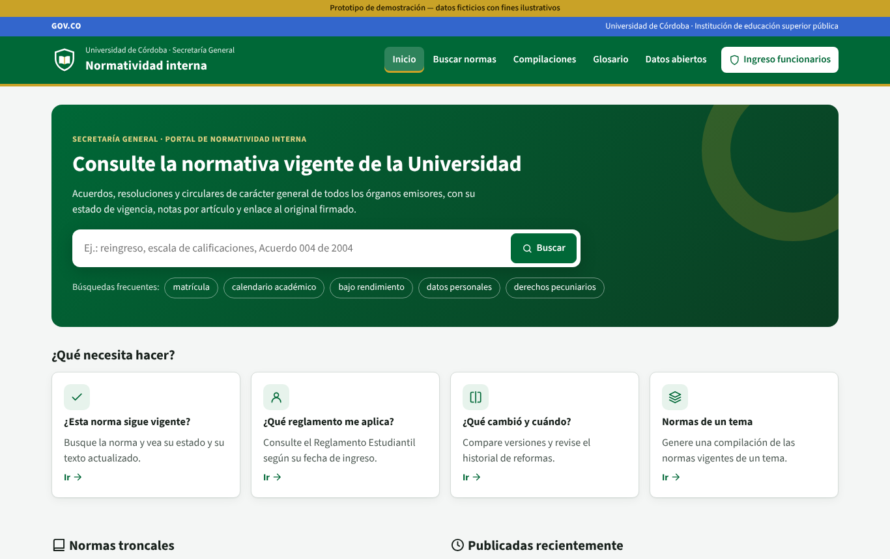
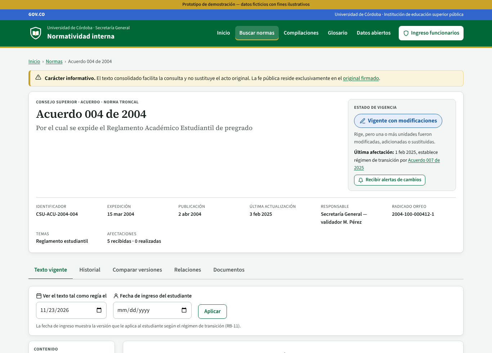
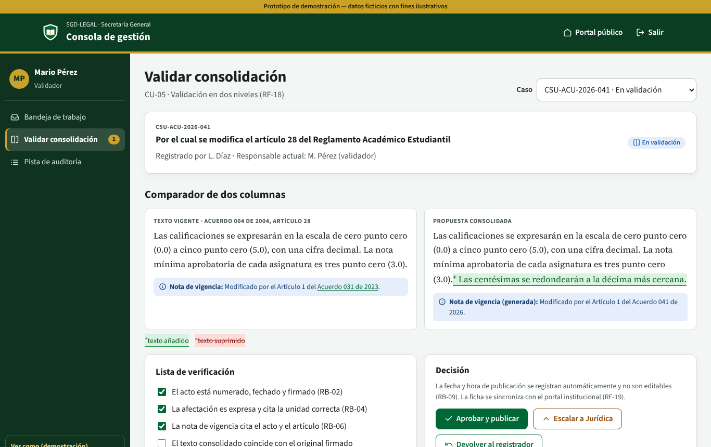

# SGD-LEGAL Unicórdoba · Prototipo navegable

[](https://github.com/innelsonn/sgd-legal-unicordoba/actions/workflows/ci.yml)

**Sistema de Gestión Documental Legal y Consolidación Normativa de la Universidad de Córdoba**

Prototipo funcional de demostración, construido a partir del documento *Análisis y especificación de requisitos v3.0* (Proyecto de aula, Análisis y diseño de sistemas, 2026-2). Muestra cómo funcionaría la plataforma para sus usuarios finales: la comunidad universitaria que consulta normas y los funcionarios de la Secretaría General que las registran, validan y publican.

> ⚠️ Prototipo académico. Todos los datos (actos, textos, personas, radicados) son **ficticios** y solo ilustran el funcionamiento. El emblema es un marcador genérico, no el escudo oficial de la Universidad.



---

## Contenido

- [Cómo ejecutarlo](#cómo-ejecutarlo)
- [Qué se puede hacer](#qué-se-puede-hacer)
- [Recorrido sugerido para una demostración](#recorrido-sugerido-para-una-demostración)
- [Estructura del proyecto](#estructura-del-proyecto)
- [Calidad: pruebas, accesibilidad y estilo](#calidad-pruebas-accesibilidad-y-estilo)
- [Documentación adicional](#documentación-adicional)
- [Limitaciones conocidas](#limitaciones-conocidas)

## Cómo ejecutarlo

No requiere instalación ni compilación: es HTML, CSS y JavaScript sin dependencias en tiempo de ejecución.

**Opción 1. Abrir el archivo.** Haga doble clic en `index.html`.

**Opción 2. Servidor local** (recomendado para presentar):

```bash
npm start
```

Abre `http://localhost:8080` en el navegador.

**Opción 3. En línea (GitHub Pages).** El flujo `.github/workflows/pages.yml` publica el prototipo en <https://innelsonn.github.io/sgd-legal-unicordoba/> cada vez que se actualiza `main`. Hay que activarlo una sola vez en *Settings → Pages → Source: GitHub Actions*.

## Qué se puede hacer

### Portal público (sin autenticación)

| Pantalla | Qué muestra | Requisitos |
|---|---|---|
| **Inicio** | Buscador, accesos por tarea («¿Esta norma sigue vigente?», «¿Qué reglamento me aplica?»…), normas troncales, publicaciones recientes y guía de estados de vigencia | RI-01, RNF-06 |
| **Buscar normas** | Texto completo sin distinción de tildes, filtros por tipo, órgano, tema, año y estado, orden por pertinencia o fecha, y fragmento del artículo donde está la coincidencia | RF-21 |
| **Ficha de la norma** | Estado de vigencia, leyenda informativa siempre visible, texto vigente con notas por artículo, consulta a una fecha y por fecha de ingreso del estudiante, historial, comparador de versiones, relaciones en ambos sentidos y documentos | RF-14 a RF-16, RF-20, RF-22 a RF-27, RF-29, RF-31, RB-01, RB-06, RB-11 |
| **Compilaciones** | Normas vigentes de uno o varios temas, con referencia al original firmado | RF-30 |
| **Glosario** | Tipos de norma, estados de vigencia y términos clave | RF-28 |
| **Datos abiertos** | Servicios REST de consulta y respuesta de ejemplo | RF-35, RI-08 |



### Consola de gestión («Ingreso funcionarios»)

El inicio de sesión institucional (SSO) está simulado: se elige un rol y, desde la barra lateral, se puede cambiar de rol en cualquier momento («Ver como»).

| Rol | Funciones |
|---|---|
| **Registrador** | Bandeja de trabajo · Reservar y anular números · Registrar un acto en 5 pasos (datos, documentos, estructura, afectaciones, revisión) · Auditoría |
| **Validador** | Validar consolidaciones con comparador de dos columnas: aprobar y publicar, escalar a Jurídica o devolver |
| **Validador jurídico** | Resolver los casos escalados |
| **Administrador** | Usuarios, roles, matriz de permisos y catálogos parametrizables |
| **Auditor** | Pista de auditoría encadenada con verificación de integridad |

Reglas de negocio que el prototipo hace cumplir, entre otras:

- **RF-05**: bloquea identificadores repetidos o números no reservados, y pide justificar una fecha distinta a la de la sesión.
- **RB-02**: no admite fechas de expedición futuras.
- **RB-03**: un número anulado nunca se reasigna.
- **RB-05**: la cláusula «deroga las disposiciones que le sean contrarias» no afecta ninguna unidad.
- **RB-12**: ninguna afectación sugerida se aplica sin confirmación humana.
- **RF-10**: las afectaciones no expresas exigen soporte formal.
- **RB-09**: la fecha de publicación se registra sola.
- **RF-13 a RF-16**: al aprobar, la ficha pública se actualiza con la nueva versión, la nota de vigencia y las relaciones.



## Recorrido sugerido para una demostración

Ver [`docs/GUION-DEMO.md`](docs/GUION-DEMO.md) (unos 8 minutos). En resumen:

1. **Portal:** busque «regimen de transicion» (sin tildes), abra el *Acuerdo 004 de 2004* y escriba una fecha de ingreso anterior a 2025 para ver la versión del Art. 40 que le aplica.
2. **Registrador:** *Registrar acto* → *Autocompletar ejemplo* → cargue los documentos, confirme las afectaciones sugeridas y envíe.
3. **Validador:** abra el caso `CSU-ACU-2026-042`, complete la lista de verificación y pulse *Aprobar y publicar*.
4. **Portal:** vuelva a la ficha y vea la nueva versión del Art. 28 con su nota de vigencia.
5. **Auditor:** pulse *Simular manipulación* y luego *Verificar integridad*.

La demo guarda su estado en la pestaña del navegador; el botón **Reiniciar demo** (barra lateral de la consola) la devuelve al estado inicial.

## Estructura del proyecto

```
sgd-legal-unicordoba/
├── index.html              Punto de entrada; carga los scripts en orden
├── styles.css              Sistema de diseño: tokens, componentes, responsive e impresión
├── assets/emblema.svg      Ícono del sitio (marcador genérico)
├── js/
│   ├── data.js             Datos de demostración (normas, versiones, bandeja, auditoría)
│   ├── utils.js            Utilidades: escape HTML, iconos, fechas, modal accesible, avisos
│   ├── state.js            Estado de la demo, roles y persistencia en sessionStorage
│   ├── normas.js           Dominio: versiones, texto a una fecha, diff, notas, publicación
│   ├── layout.js           Cabecera, pie y estructura de la consola
│   ├── router.js           Enrutador por hash con tabla de rutas y control de acceso
│   └── views/
│       ├── publico.js      Inicio, búsqueda, ficha, glosario, compilaciones, API, ingreso
│       ├── consola.js      Bandeja de trabajo y reserva de números
│       ├── registro.js     Asistente de registro (CU-02, CU-03, CU-04)
│       ├── validacion.js   Validación en dos niveles (CU-05)
│       └── administracion.js  Auditoría encadenada y administración
├── tests/e2e.test.js       27 pruebas de extremo a extremo (Playwright + node:test + axe-core)
└── docs/                   Arquitectura, diseño, trazabilidad, guion de demo y capturas
```

Las decisiones técnicas están explicadas en [`docs/ARQUITECTURA.md`](docs/ARQUITECTURA.md).

## Calidad: pruebas, accesibilidad y estilo

```bash
npm install                         # dependencias de desarrollo
npx playwright install chromium     # navegador para las pruebas (una sola vez)
npm test                            # 27 pruebas de extremo a extremo
npm run lint                        # ESLint
npm run check                       # lint + formato + pruebas
```

Las pruebas verifican:

- que todas las rutas cargan sin errores;
- la búsqueda sin tildes;
- la consulta a una fecha y por fecha de ingreso;
- las notas de vigencia;
- los permisos por rol;
- la no reasignación de números anulados;
- el flujo completo registrar → validar → publicar → ficha actualizada;
- la detección de manipulación en la auditoría;
- la ausencia de desplazamiento horizontal a 360 px (RNF-08);
- la auditoría automática de accesibilidad **WCAG 2.1 AA** con axe-core, sin violaciones graves ni críticas (RNF-07).

El flujo `.github/workflows/ci.yml` las ejecuta en cada cambio de `main` y en cada pull request.

## Documentación adicional

| Documento | Contenido |
|---|---|
| [`docs/ARQUITECTURA.md`](docs/ARQUITECTURA.md) | Tecnología, organización del código, flujo de datos y convenciones |
| [`docs/DISENO.md`](docs/DISENO.md) | Decisiones de diseño derivadas de los hallazgos del documento y revisión de usabilidad |
| [`docs/TRAZABILIDAD.md`](docs/TRAZABILIDAD.md) | Matriz requisito → pantalla → prueba |
| [`docs/GUION-DEMO.md`](docs/GUION-DEMO.md) | Guion paso a paso para presentar el prototipo |
| [`CHANGELOG.md`](CHANGELOG.md) | Historial de versiones del prototipo |

## Licencia

Código bajo licencia [Apache 2.0](LICENSE). Los datos de demostración son ficticios.

## Limitaciones conocidas

- No hay servidor: la autenticación, las descargas de PDF y el envío de alertas por correo están **simulados**.
- Los cambios hechos durante la demo se guardan solo en la pestaña actual (`sessionStorage`).
- La huella de los documentos y de la auditoría usa un hash de demostración; el sistema real usaría SHA-256 en el servidor (RNF-04, RF-33).
- La estructuración automática del texto y las sugerencias de afectación muestran resultados predefinidos.
